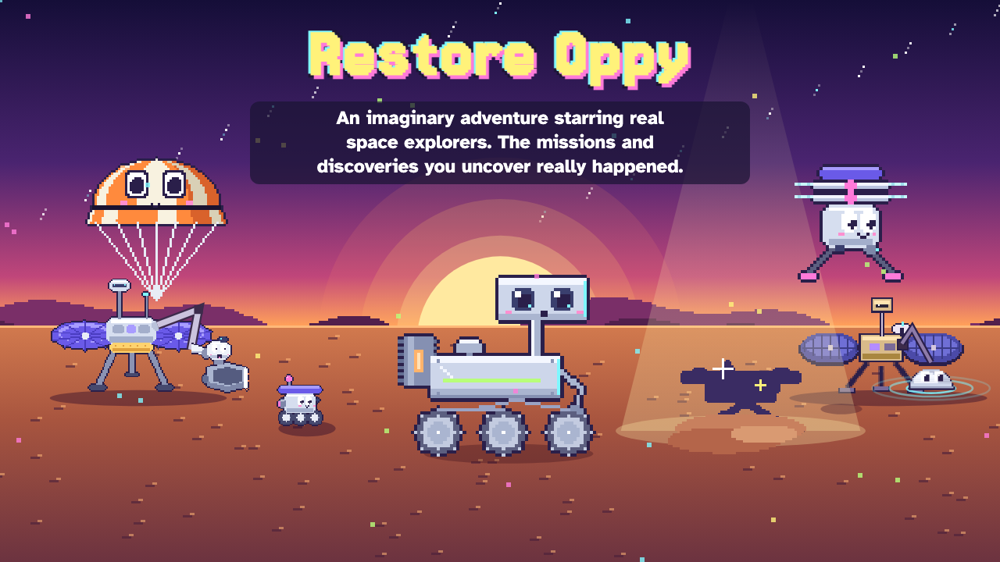
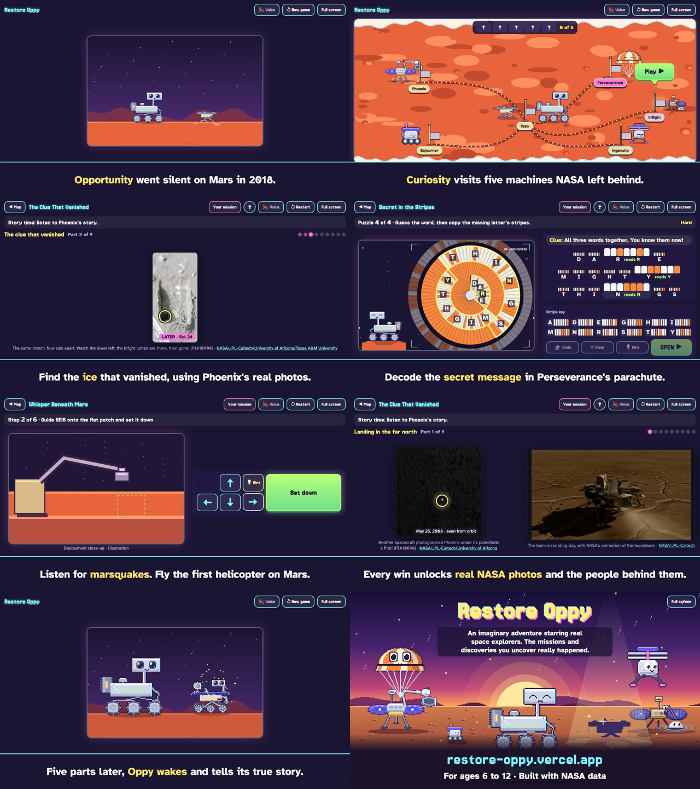
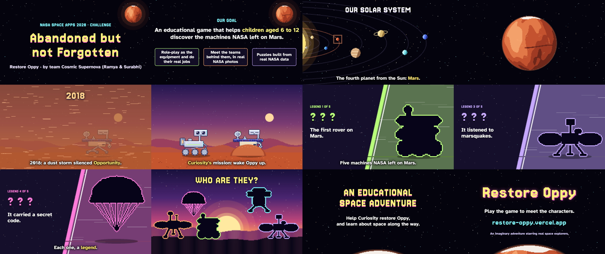

# Restore Oppy



**Play it:** https://restore-oppy.vercel.app

Restore Oppy is a browser-based pixel-art adventure that introduces children ages 6–12 to the real equipment NASA left on Mars and the discoveries it made possible. Players guide Curiosity across a Mars map and complete five mini-missions inspired by Sojourner, Phoenix’s robotic scoop, InSight’s seismometer, Perseverance’s parachute, and Ingenuity.

Each mission unlocks a story told from the equipment’s point of view, paired with real NASA photos, video, or measurements. Players collect repair parts in any order and bring them together in a fictional finale that wakes Opportunity. The finale then tells the real story of Opportunity’s discoveries and why the rover went silent. By letting children try a simplified version of each machine’s job before seeing the real evidence, the game helps them understand what the hardware did and why its work still matters.

**The game**



**The trailer**



## Project details

### How it works

The player explores a Mars map as Curiosity and chooses which mission to visit next. Each mini-game is based on a different job. Players guide Sojourner to a rock so it can study it with its rear-mounted instrument, uncover clues with Phoenix, place InSight’s seismometer and match vibration patterns, decode Perseverance’s parachute, and plan an Ingenuity flight. Finishing a mission unlocks a story scene and earns a repair part. After collecting all five parts, players assemble them on Opportunity and unlock its final story.

#### Five mini-games

| Equipment | Mini-game | What the child learns |
|---|---|---|
| Sojourner (Mars Pathfinder, 1997) | *Track Detective*: plan a forward-only drive and back up to a rock, because Sojourner's rock tool (APXS) was on its back | How the first Mars rover was driven from Earth and how it measured rocks |
| Phoenix lander (2008) | *The Clue That Vanished*: dig a trench, compare two real photos taken days apart, find the chunks that disappeared | Bright chunks that vanish are water ice turning to vapour (sublimation) |
| InSight (2018 to 2022) | *Whisper Beneath Mars*: lower the seismometer and its wind shield with the arm, then match quake traces | Marsquakes let scientists see inside a planet |
| Perseverance's parachute (2021) | *Secret in the Stripes*: copy each letter's stripe pattern from a key to decode the canopy's message | Engineers hid "Dare Mighty Things" in binary on the parachute |
| Ingenuity helicopter (2021 to 2024) | *Flight Plan*: plan waypoints, spot landmarks, choose a safe landing patch | The first powered flight on another world, 72 flights, and why it stopped |

### How we use NASA data

The story scenes connect each activity to mission evidence. Phoenix’s before-and-after trench images let players see the bright chunks disappear, then learn why that change was evidence of exposed water ice. InSight’s story presents a NASA visualization and audio made from real SEIS measurements so players can follow the recorded vibrations from Martian wind, a likely marsquake, and movement of the lander’s arm. Opportunity’s story uses mission imagery to explain how the rover looked for evidence of past water and what happened when it lost contact. NASA imagery and data are credited in the story scenes.

### Why we made it

We wanted kids to remember what each piece of equipment helped them learn. The equipment speaks in character, giving players a reason to care about what happened to it. The real mission scenes explain the hardware, introduce people who worked on it, and show how scientists made sense of the evidence. Curiosity’s and Opportunity’s interactions are fictional. The mission records and observations come from NASA sources.

### Who it is for and accessibility

- Ages 6 to 12, with simple choices for younger players and optional "for big kids" extras.
- Dialogue uses recorded ElevenLabs voices where available and browser speech for other lines, with captions that appear word by word and highlight key words. Body text uses Atkinson Hyperlegible, a font
  designed to tell letters apart. Keyboard and mouse or touch controls. Replay buttons and hints.
- Runs in any modern browser with no install or account. Progress saves on the device.

### How we built it

Plain HTML, CSS, and JavaScript, with no framework, so it loads fast and runs on school computers.

All pixel art is original and drawn in code by our own Node.js scripts. No AI image generation was used.

Each game is built from a template by a Node.js script. Python and Node.js checkers prove every puzzle board is solvable and that difficulty rises from puzzle to puzzle.

Tools: Git and GitHub, Node.js, Python, Vercel for hosting, Claude Code and OpenAI Codex for code development and ElevenLabs for voiceover and audio generation.

### What's next

More languages, a teacher guide with classroom questions, and new chapters for Moon hardware (Apollo rovers and experiments).

## Project links and attachments

- [Play Restore Oppy](https://restore-oppy.vercel.app/)
- [Game source code](https://github.com/surxbhi/restore_oppy)
- [30-second trailer with narration, music, and sound effects](https://github.com/surxbhi/cosmic_supernova/blob/main/submission/demo/restore-oppy-trailer-full-score.mp4)
- [Gameplay demo](https://github.com/surxbhi/cosmic_supernova/blob/main/submission/demo/restore-oppy-demo.mp4)
- [Trailer storyboard](https://github.com/surxbhi/cosmic_supernova/blob/main/submission/demo/trailer-storyboard.png) and [gameplay demo storyboard](https://github.com/surxbhi/cosmic_supernova/blob/main/submission/demo/storyboard.png)
- [Trailer voice-over script](https://github.com/surxbhi/cosmic_supernova/blob/main/submission/demo/TRAILER-VOICEOVER.md) and [gameplay demo voice-over script](https://github.com/surxbhi/cosmic_supernova/blob/main/submission/demo/VOICEOVER.md)
- [Full submission pack, including NASA sources and credits](https://github.com/surxbhi/cosmic_supernova/blob/main/submission/SUBMISSION.md)

The in-game character voices and sound effects, and the trailer narration, background music and sound effects, were AI-generated with ElevenLabs. All pixel art is drawn in code; no AI image generation was used.

## Space Agency Partner & Other Data

### NASA data

The missions, dates, people, photos and videos come from NASA. The game links 102 NASA pages, images and videos on screen. The main ones are in this table, and every one is listed after it.

| Source | Public URL | Use in the project |
| --- | --- | --- |
| NASA Science mission pages | <https://science.nasa.gov/mission/mars-pathfinder/>, <https://science.nasa.gov/mission/phoenix/>, <https://science.nasa.gov/mission/insight/>, <https://science.nasa.gov/mission/mars-2020-perseverance/ingenuity-mars-helicopter/>, <https://science.nasa.gov/mission/mer-opportunity/>, <https://science.nasa.gov/mission/msl-curiosity/> | Mission facts, dates and discoveries for every piece of equipment and for Curiosity and Opportunity |
| NASA Photojournal | <https://science.nasa.gov/photojournal/> | Real photos in story times (Sojourner and Yogi, Disappearing Ice, SEIS deployed, Opportunity's last message, Ingenuity's hard landing and more) |
| NASA JPL images and news | <https://www.jpl.nasa.gov/news/> | Mission news used for facts, such as the parachute's "Mars decoder ring" (PIA24431) and Ingenuity's first flight |
| First likely marsquake heard by InSight | <https://science.nasa.gov/resource/first-likely-marsquake-heard-by-nasas-insight/> | The InSight story-time video and sound |
| Perseverance descent and touchdown video | <https://science.nasa.gov/resource/perseverance-rovers-descent-and-touchdown-on-mars-onboard-camera-views/> | The parachute opening in Chute's story time |

#### Every NASA link the game uses

#### NASA Science (science.nasa.gov): missions, Photojournal images and resources (49)

- <https://assets.science.nasa.gov/content/dam/science/psd/mars/downloadable_items/4/5/45687_PIA24270-HiRISE_Captured_Perseverance_During_Descent.jpg>
- <https://science.nasa.gov/image-detail/steve-squyres-voyager/>
- <https://science.nasa.gov/mission/insight/>
- <https://science.nasa.gov/mission/mars-2020-perseverance/ingenuity-mars-helicopter/>
- <https://science.nasa.gov/mission/mars-exploration-rovers-spirit-and-opportunity/>
- <https://science.nasa.gov/mission/mars-pathfinder/>
- <https://science.nasa.gov/mission/mer-opportunity/>
- <https://science.nasa.gov/mission/msl-curiosity/>
- <https://science.nasa.gov/mission/msl-curiosity/science-highlights/>
- <https://science.nasa.gov/mission/msl-curiosity/science/>
- <https://science.nasa.gov/mission/phoenix/>
- <https://science.nasa.gov/missions/mer/nasas-opportunity-rover-mission-on-mars-comes-to-end/>
- <https://science.nasa.gov/missions/mer/six-things-to-know-about-nasas-opportunity-rover/>
- <https://science.nasa.gov/photojournal/>
- <https://science.nasa.gov/photojournal/berries-here-there-everywhere>
- <https://science.nasa.gov/photojournal/countdown-to-launch/>
- <https://science.nasa.gov/photojournal/curiosity-at-work-on-mars-artists-concept>
- <https://science.nasa.gov/photojournal/curiosity-leaves-its-mark/>
- <https://science.nasa.gov/photojournal/curiosity-spotted-on-parachute-by-orbiter>
- <https://science.nasa.gov/photojournal/disappearing-ice/>
- <https://science.nasa.gov/photojournal/eyeing-eagle-crater/>
- <https://science.nasa.gov/photojournal/homestake-vein-on-cape-york-color-enhanced/>
- <https://science.nasa.gov/photojournal/ingenuitys-hard-landing>
- <https://science.nasa.gov/photojournal/lander-and-mini-matterhorn-rock/>
- <https://science.nasa.gov/photojournal/mastcam-z-video-of-ingenuity-taking-off-and-landing>
- <https://science.nasa.gov/photojournal/mount-sharp-photobombs-curiosity/>
- <https://science.nasa.gov/photojournal/nasas-mars-chopper-concept-rendering/>
- <https://science.nasa.gov/photojournal/opportunity-legacy-pan-true-color>
- <https://science.nasa.gov/photojournal/opportunity-slices-into-the-surface-of-mars/>
- <https://science.nasa.gov/photojournal/opportunitys-last-message>
- <https://science.nasa.gov/photojournal/pathfinders-rover-airbags-and-martian-terrain/>
- <https://science.nasa.gov/photojournal/perseverances-mastcam-z-video-of-ingenuity-hovering/>
- <https://science.nasa.gov/photojournal/perseverances-selfie-with-ingenuity/>
- <https://science.nasa.gov/photojournal/rovers-backshell-seen-from-the-air/>
- <https://science.nasa.gov/photojournal/seis-deployed-on-mars/>
- <https://science.nasa.gov/photojournal/sojourner-and-yogi/>
- <https://science.nasa.gov/photojournal/sojourner-barnacle-bill-and-yogi/>
- <https://science.nasa.gov/photojournal/sojourner-near-barnacle-bill/>
- <https://science.nasa.gov/photojournal/sojourners-first-images-from-mars/>
- <https://science.nasa.gov/photojournal/swatch-of-wright-brothers-flyer-1-attached-to-mars-helicopter>
- <https://science.nasa.gov/photojournal/view-of-yellowknife-bay-formation-with-drilling-sites/>
- <https://science.nasa.gov/photojournal/work-on-phoenix-science-deck/>
- <https://science.nasa.gov/resource/apxs-on-barnacle-bill-color/>
- <https://science.nasa.gov/resource/discovery-served-up-in-a-bowl/>
- <https://science.nasa.gov/resource/first-likely-marsquake-heard-by-nasas-insight/>
- <https://science.nasa.gov/resource/hirise-captured-perseverance-during-descent-to-mars/>
- <https://science.nasa.gov/resource/perseverance-rovers-descent-and-touchdown-on-mars-onboard-camera-views/>
- <https://science.nasa.gov/resource/remnants-of-ancient-streambed-on-mars/>
- <https://science.nasa.gov/resource/the-third-color-image-taken-by-ingenuity/>

#### NASA JPL (jpl.nasa.gov): images, news, videos and press kits (42)

- <https://jpl.nasa.gov/news/news.php?feature=1936>
- <https://www.jpl.nasa.gov/images/parachute-for-perseverance>
- <https://www.jpl.nasa.gov/images/pia00627/>
- <https://www.jpl.nasa.gov/images/pia00994-color-enhanced-version-of-360-degree-panorama/>
- <https://www.jpl.nasa.gov/images/pia01154-rock-and-soil-types-at-pathfinder-landing-site/>
- <https://www.jpl.nasa.gov/images/pia05657-visiting-the-scene-of-landing/>
- <https://www.jpl.nasa.gov/images/pia09104-panorama-from-cape-verde/>
- <https://www.jpl.nasa.gov/images/pia11724-frost-seen-on-snow-white-trench/>
- <https://www.jpl.nasa.gov/images/pia15033-homestake-vein-in-color/>
- <https://www.jpl.nasa.gov/images/pia15115-dusty-mars-rovers-self-portrait/>
- <https://www.jpl.nasa.gov/images/pia19141-opportunity-rover-nears-mars-marathon-feat/>
- <https://www.jpl.nasa.gov/images/pia19807-curiosity-low-angle-self-portrait-at-buckskin-drilling-site-on-mount-sharp/>
- <https://www.jpl.nasa.gov/images/pia22909-opportunity-legacy-pan-true-color/>
- <https://www.jpl.nasa.gov/images/pia22929-opportunitys-last-message/>
- <https://www.jpl.nasa.gov/images/pia24431-mars-decoder-ring/>
- <https://www.jpl.nasa.gov/images/pia25217-rover-landing-gear-seen-from-the-air-by-mars-helicopter/>
- <https://www.jpl.nasa.gov/images/pia26814-comparing-off-world-rover-driving-distances/>
- <https://www.jpl.nasa.gov/images/slice-of-history-mars-pathfinder-rover-team-1994/>
- <https://www.jpl.nasa.gov/missions/mars-science-laboratory-curiosity-rover-msl/>
- <https://www.jpl.nasa.gov/news/curiosity-meet-clara/>
- <https://www.jpl.nasa.gov/news/final-attempts-to-hear-from-mars-phoenix-scheduled/>
- <https://www.jpl.nasa.gov/news/mars-2020-parachute-a-go/>
- <https://www.jpl.nasa.gov/news/nasa-mars-lander-sees-falling-snow-soil-data-suggest-liquid-past/>
- <https://www.jpl.nasa.gov/news/nasa-mars-rover-finds-mineral-vein-deposited-by-water/>
- <https://www.jpl.nasa.gov/news/nasa-performs-first-aircraft-accident-investigation-on-another-world/>
- <https://www.jpl.nasa.gov/news/nasa-rover-finds-conditions-once-suited-for-ancient-life-on-mars/>
- <https://www.jpl.nasa.gov/news/nasa-rover-finds-old-streambed-on-martian-surface/>
- <https://www.jpl.nasa.gov/news/nasa-spacecraft-confirms-martian-water-mission-extended/>
- <https://www.jpl.nasa.gov/news/nasa-to-check-for-unlikely-winter-survival-of-mars-lander/>
- <https://www.jpl.nasa.gov/news/nasas-curiosity-rover-detects-largest-organic-molecules-found-on-mars/>
- <https://www.jpl.nasa.gov/news/nasas-ingenuity-mars-helicopter-succeeds-in-historic-first-flight/>
- <https://www.jpl.nasa.gov/news/nasas-ingenuity-mars-helicopter-team-says-goodbye-for-now/>
- <https://www.jpl.nasa.gov/news/nasas-mars-perseverance-rover-provides-front-row-seat-to-landing-first-audio-recording-of-red-planet/>
- <https://www.jpl.nasa.gov/news/nasas-opportunity-mars-rover-passes-marathon-distance/>
- <https://www.jpl.nasa.gov/news/nasas-perseverance-sets-off-world-record-for-total-distance-driven/>
- <https://www.jpl.nasa.gov/news/opportunity-rover-finds-strong-evidence-meridiani-planum-was-wet/>
- <https://www.jpl.nasa.gov/news/press_kits/insight/landing/mission/science/>
- <https://www.jpl.nasa.gov/news/press_kits/mars_2020/landing/mission/>
- <https://www.jpl.nasa.gov/news/six-things-about-opportunitys-recovery-efforts/>
- <https://www.jpl.nasa.gov/podcasts/on-a-mission-season-1/season-4-mars-rovers/episode-4-a-lifetime-on-mars-the-adventures-of-spirit-and-opportunity/>
- <https://www.jpl.nasa.gov/videos/curiositys-seven-minutes-of-terror/>
- <https://www.jpl.nasa.gov/videos/phoenix-mars-landing-nerves-and-joy/>

#### NASA (nasa.gov) and NASA Astrobiology (7)

- <https://astrobiology.nasa.gov/missions/mer/>
- <https://www.nasa.gov/history/curiosity-celebrates-10-years-on-mars/>
- <https://www.nasa.gov/image-article/atlas-v-roars-msl-mars-bound/>
- <https://www.nasa.gov/image-article/july-7-2003-nasas-opportunity-rover-launches-mars/>
- <https://www.nasa.gov/missions/mars-2020-perseverance/ingenuity-helicopter/nasas-ingenuity-mars-helicopter-team-says-goodbye-for-now/>
- <https://www.nasa.gov/missions/mars-2020-perseverance/ingenuity-helicopter/nasas-mars-helicopter-spots-gear-that-helped-perseverance-rover-land/>
- <https://www.nasa.gov/news-release/after-three-years-on-mars-nasas-ingenuity-helicopter-mission-ends/>

#### NASA image files (NASA/JPL-Caltech, served from NASA's image CDN) (4)

- <https://d2pn8kiwq2w21t.cloudfront.net/original_images/jpegPIA11724.jpg>
- <https://d2pn8kiwq2w21t.cloudfront.net/original_images/jpegPIA23890.jpg>
- <https://d2pn8kiwq2w21t.cloudfront.net/original_images/jpegPIA25217.jpg>
- <https://d2pn8kiwq2w21t.cloudfront.net/original_images/jpegPIA25218.jpg>

### Other data

| Link text | Public URL | Use in the project |
| --- | --- | --- |
| Mars Helicopter Team (2018) | <https://commons.wikimedia.org/wiki/File%3AMars_Helicopter_Team_%282018%29.jpg> | NASA/JPL-Caltech team photo, via Wikimedia Commons |
| First Likely Marsquake Heard by NASA’s InSight | <https://commons.wikimedia.org/wiki/File%3ANASA-Mars-InSightLander-MarsQuake-Seismometer-AV-20190406.webm> | NASA/JPL video and audio, via Wikimedia Commons |
| Phoenix Mars Mission Lands Doctorate for Peter Smith | <https://news.arizona.edu/news/phoenix-mars-mission-lands-doctorate-peter-smith> | University of Arizona background on the Phoenix mission and its principal investigator |
| Sojourner technical report | <https://www.osti.gov/servlets/purl/462910> | Technical background on Sojourner |
| The Women of JPL | <https://d2pn8kiwq2w21t.cloudfront.net/documents/The_Women_of_JPL_Final.pdf> | Background on Donna Shirley |

### Fonts and tools

| Link text | Public URL | Use in the project |
| --- | --- | --- |
| Atkinson Hyperlegible | <https://fonts.google.com/specimen/Atkinson+Hyperlegible> | Body text font |
| Jersey 15 | <https://fonts.google.com/specimen/Jersey+15> | Pixel-style display font |
| Node.js | <https://nodejs.org/> | Game build scripts and puzzle checks |
| Python | <https://www.python.org/> | Puzzle checks |
| Git | <https://git-scm.com/> | Version control |
| GitHub | <https://github.com/> | Source code and submission assets |
| Vercel | <https://vercel.com/> | Game hosting |
| Claude Code | <https://www.anthropic.com/claude-code> | Coding and testing assistance |
| Claude | <https://claude.ai/> | Story-script drafting assistance |
| ElevenLabs | <https://elevenlabs.io/> | Character voices, game sound effects, and trailer narration, music, and sound effects |
| OpenAI Codex | <https://openai.com/codex/> | Coding assistance |
| OpenAI ChatGPT | <https://chatgpt.com/> | Story and script editing assistance |

## Run it locally

It is plain HTML, CSS and JavaScript with no install. Serve the repo root and open the game:

```bash
python3 -m http.server 8000
```

Then open http://localhost:8000/prototype/restore-oppy.html. On localhost only, `?dev=1` shows a developer panel for jumping to any scene.

## What's where

- `prototype/` is the game:
  - `restore-oppy.html` is the map page, and the other `*.html` files are the five games.
  - `stage.js` scales the page to the window, `captions.js` shows the words as they are spoken, `voice.js` plays the recordings, `giftbox.js` is the reward box, and `house.css` holds the shared styles.
  - `script/*.script.js` holds every spoken line, by ID.
  - `audio/` holds one recording per line ID, and `media/` holds the NASA pictures and videos.
- `storytimes/stories.js` and `storytimes/media/` hold the story-time stories and their NASA photos.
- `art/out/` holds the pixel-art sprite sheets the builds read.
- `tools/` holds the build scripts, the puzzle checkers and the voice tools.

## Changing the game

Each page is built from its `prototype/<page>.template.html`. Edit the template, then rebuild:

```bash
node tools/build_hub.mjs
```

That one rebuilds the map page. The others are:

- `node tools/make_sprites.mjs`: Track Detective and InSight
- `node tools/make_phoenix_sprites.mjs`: Phoenix
- `node tools/make_ingenuity_sprites.mjs`: Ingenuity
- `node tools/make_perseverance_sprites.mjs`: Chute

The puzzle checkers prove every board can be solved. All five should pass:

- `python3 tools/verify_track_boards.py`
- `python3 tools/verify_phoenix_cases.py`
- `python3 tools/verify_ingenuity_flights.py`
- `python3 tools/verify_perseverance_puzzles.py`
- `node tools/verify_insight.mjs`

## Voices

Spoken lines live in `prototype/script/*.script.js`. Edit the words there; no rebuild is needed. Each line plays `prototype/audio/<line id>.mp3` if it exists, and otherwise the browser's own voice reads it.

- `node tools/export_script.mjs` lists every line, checks the script, and marks any recording whose words have since changed as OUT OF DATE.
- `node tools/elevenlabs_generate.mjs <line id>` makes a new recording with ElevenLabs. It needs `ELEVENLABS_API_KEY` in a `.env` file, which is never committed. The voices are set in `tools/elevenlabs_voices.json`.
- `node tools/build_audio_manifest.mjs` updates the list of recordings after you add or replace any.
- Sound effects (digging, driving, chimes) are in `prototype/sfx/`, played by `prototype/sfx.js`. `node tools/elevenlabs_sfx.mjs` makes any missing ones with ElevenLabs Sound Effects.

## Deploying

See [DEPLOY.md](DEPLOY.md).
